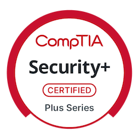
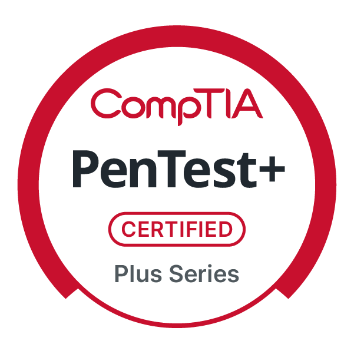

👋 hey, i'm fernando

**Security Engineer · Detection Engineering · Cloud Security · DFIR**

  
  

## 🛠️ Technologies & Tools I've Worked With

**Languages & platforms**

**Detection, SIEM & IR**

**DevSecOps**

**AI security**

---

## 🧠 Exploring: AI Security

AI agents are getting access to real tools and real data, and that opens up new attack surface. I'm exploring how to secure them from the defensive side:

- How prompt injection and tool poisoning work against LLM agents that use MCP tools
- Which defenses actually hold up, measured by both security and utility so protection doesn't break usefulness
- How classic security thinking (detection, least privilege, policy gates) carries over to AI systems

My hands-on starting point is [mcp-security-lab](https://github.com/FCortezSecurity/mcp-security-lab).

## 📚 How I Learn

I'm building skills in the open, project by project. My ideas and learning come from:

- 🎥 YouTube walkthroughs and tutorials
- 💬 Reddit communities for cybersecurity careers and home labs
- 📱 TikTok for project ideas and quick concepts
- 🤖 Hands-on with AI tools (LLM assistants, agents, MCP) to learn how they work and how they can be attacked, which is what drew me into AI security

Every repo is a real build with documented results, and I keep adding to it as I learn.

---

## 🚀 Featured Projects

### 🤖 [mcp-security-lab](https://github.com/FCortezSecurity/mcp-security-lab)
A local lab for attacking and defending an LLM agent that uses MCP tools. Covers prompt injection and tool poisoning, then tests defenses with measured security and utility results.

### 🍯 [honeymap](https://github.com/FCortezSecurity/honeymap)
A honeypot threat-intelligence pipeline that parses attacker activity, enriches it, detects patterns, and maps the attacks.

### 🛡️ [aegis-fusion](https://github.com/FCortezSecurity/aegis-fusion)
DevSecOps automation that runs Bandit, pip-audit, Gitleaks, Checkov, and Trivy, normalizes the findings, and enforces a policy gate in GitHub Actions.

### ☁️ [cloud-security-detection-suite](https://github.com/FCortezSecurity/cloud-security-detection-suite)
A consolidated AWS security toolkit: IAM configuration auditing, CloudTrail threat detection, and Splunk-based investigation workflows.

### 🪟 [windows-endpoint-detection-ir](https://github.com/FCortezSecurity/windows-endpoint-detection-ir)
A Windows endpoint detection and incident response lab using Sysmon and Splunk. Includes 5 tuned detections with false-positive analysis, 2 full incident investigations, and MITRE ATT&CK mapping.

---

*My earlier AWS projects (IAM audit, CloudTrail detection, CloudTrail + Splunk lab) are archived and were merged into cloud-security-detection-suite.*
